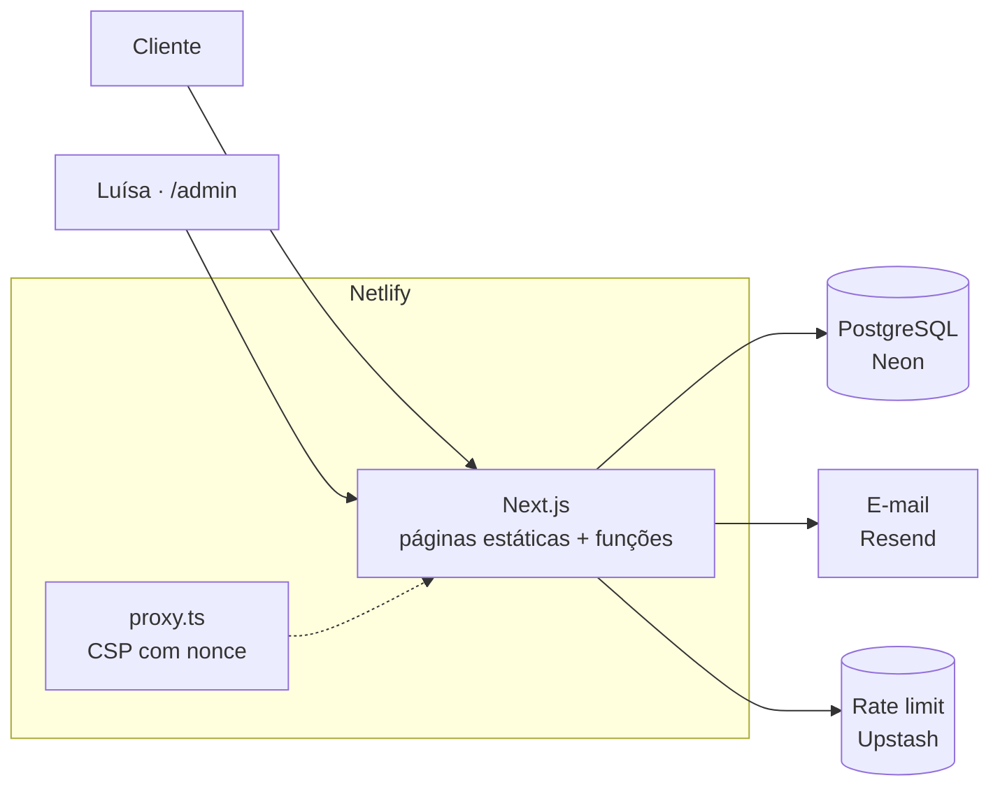

<div align="center">

# Luísa Silva Ramos · Maquiadora Profissional

**Site institucional, agendamento online e painel administrativo**
para a maquiadora Luísa Silva Ramos.

[](https://github.com/Leo300609/luisasilvaramos.site/actions/workflows/ci.yml)
[](https://app.netlify.com/projects/effortless-meringue-dd2411/deploys)


[**luisasilvaramos.com.br**](https://luisasilvaramos.com.br) ·
[Documentação](docs) ·
[Decisões técnicas](docs/adr) ·
[Runbook](docs/runbook.md)

</div>

---

## Sobre o projeto

Uma maquiadora atende noivas, formandas e convidadas de festas, quase sempre **na casa da cliente
ou no local do evento**. Este projeto substitui a troca de mensagens para combinar horário por um fluxo
de agendamento online pensado para esse trabalho:

- a cliente escolhe o serviço, informa **o horário do evento e o endereço**, e o sistema sugere o
  melhor horário para a maquiagem, já calculando a **taxa de deslocamento** e bloqueando na agenda
  o tempo de ida e volta;
- ao confirmar, ela aceita um **contrato eletrônico** gerado automaticamente;
- a Luísa recebe tudo num **painel** com agenda (mês, semana e dia), confirmações, clientes,
  serviços, horários e relatórios.

O visual segue fielmente o design criado no Claude Design: paleta dourada e café, tipografia
Cormorant Garamond + Jost e versões desktop, tablet e mobile.

## Funcionalidades

| Área                        | Destaques                                                                                           | Status          |
| --------------------------- | --------------------------------------------------------------------------------------------------- | --------------- |
| **Fundação**                | Next.js 16, TypeScript strict, tokens do design, cabeçalhos de segurança, CSP com nonce, CI, deploy | ✅ Concluída    |
| **Site público**            | Hero, sobre, serviços, portfólio com lightbox, depoimentos, contato, SEO local                      | 🚧 Em andamento |
| **Núcleo de agendamento**   | Algoritmo de disponibilidade, deslocamento, anti-conflito no banco (PostgreSQL `EXCLUDE`)           | ⏳ Planejado    |
| **Agendamento da cliente**  | 5 passos, contrato eletrônico, "Minha agenda", reagendar/cancelar por link seguro, `.ics`           | ⏳ Planejado    |
| **Painel da Luísa**         | Login com 2FA, dashboard, agenda com arrastar e soltar, clientes, serviços, CSV                     | ⏳ Planejado    |
| **Automação e LGPD**        | Lembretes, expiração de pendentes, retenção de dados, direitos do titular                           | ⏳ Planejado    |
| **Endurecimento e go-live** | E2E completos, carga, auditoria de acessibilidade, monitoramento                                    | ⏳ Planejado    |

O plano completo, com lacunas do design, modelo de dados e riscos, está em
[`docs/fase-0-descoberta.md`](docs/fase-0-descoberta.md).

## Stack

| Camada         | Tecnologia                                                                                  |
| -------------- | ------------------------------------------------------------------------------------------- |
| Framework      | [Next.js 16](https://nextjs.org) (App Router, Server Components, Server Actions) + React 19 |
| Linguagem      | TypeScript em modo estrito (`noUncheckedIndexedAccess`)                                     |
| Interface      | Tailwind CSS 4 com tokens do design · fontes self-hosted                                    |
| Validação      | Zod em todas as bordas (inclusive variáveis de ambiente)                                    |
| Banco de dados | PostgreSQL (Neon) + Drizzle ORM, _a partir da Fase 3_                                       |
| E-mail         | Resend com padrão outbox, _a partir da Fase 4_                                              |
| Testes         | Vitest · Playwright · axe-core                                                              |
| Hospedagem     | Netlify (previews por pull request)                                                         |
| CI/CD          | GitHub Actions · Dependabot                                                                 |

## Arquitetura



- **Site público** estático (rápido e barato); **agendamento e painel** renderizados por requisição.
- Toda regra de negócio roda **no servidor**: disponibilidade, preço, deslocamento e status.
- Decisões registradas como ADRs em [`docs/adr/`](docs/adr).

## Começando

### Pré-requisitos

- [Node.js 22](https://nodejs.org) (`nvm use` lê o `.nvmrc`)
- [Git](https://git-scm.com)

### Instalação

```bash
git clone https://github.com/Leo300609/luisasilvaramos.site.git
cd luisasilvaramos.site
npm ci
cp .env.example .env.local
npm run dev
```

Abra <http://localhost:3000>.

> **Windows (PowerShell):** se aparecer _"a execução de scripts foi desabilitada"_, use `npm.cmd`
> e `npx.cmd` no lugar de `npm` e `npx`, ou rode os comandos no Prompt de Comando (`cmd`).

### Variáveis de ambiente

Todas estão documentadas em [`.env.example`](.env.example) e são validadas no build e na
inicialização: se faltar alguma, o erro diz **qual** (sem expor o valor). Segredos nunca vão para o
repositório; em produção eles ficam nas variáveis da Netlify.

## Scripts

| Comando             | Descrição                                                              |
| ------------------- | ---------------------------------------------------------------------- |
| `npm run dev`       | Servidor de desenvolvimento                                            |
| `npm run build`     | Build de produção                                                      |
| `npm run start`     | Sobe o build de produção                                               |
| `npm run lint`      | ESLint, zero avisos tolerados                                          |
| `npm run typecheck` | Checagem de tipos                                                      |
| `npm run format`    | Formata com Prettier                                                   |
| `npm test`          | Testes unitários (Vitest)                                              |
| `npm run test:e2e`  | Testes E2E + acessibilidade (Playwright + axe). Requer `npm run build` |
| `npm run check`     | Tudo acima, na ordem da CI. **Rode antes de abrir um PR**              |

Primeira vez com os testes E2E: `npx playwright install chromium`.

## Estrutura

```
src/
├── app/                  rotas, layout, páginas de erro e API
├── assets/               imagens otimizadas pelo next/image
├── components/
│   └── site/             seções do site público (header, hero, portfólio…)
├── content/              textos e dados do site (placeholders do design marcados)
├── env/                  esquema e validação das variáveis de ambiente
├── server/
│   ├── db/               esquema Drizzle e conexão
│   ├── scheduling/       disponibilidade, deslocamento, fuso (regras puras)
│   ├── booking/          criação de agendamentos (transação, trava, idempotência)
│   └── crypto/           cifragem de campos sensíveis
├── lib/
│   ├── security/         cabeçalhos HTTP e Content Security Policy
│   └── observability/    logger estruturado sem dados pessoais
└── proxy.ts              CSP com nonce nas áreas dinâmicas
tests/
├── unit/                 Vitest
├── db/                   Vitest + Postgres (regras, concorrência)
└── e2e/                  Playwright + axe
docs/
├── fase-0-descoberta.md  descoberta, arquitetura, modelo de dados
├── architecture.md       diagramas: contexto, dados, algoritmo
├── adr/                  decisões de arquitetura
└── runbook.md            deploy, rollback, operação
```

## Qualidade e segurança

- **CI obrigatória** em todo pull request: lint, tipos, formatação, testes unitários com cobertura,
  build, E2E em desktop e mobile, e auditoria de dependências.
- **Acessibilidade:** WCAG 2.1 AA verificada automaticamente com axe, foco visível e navegação por
  teclado.
- **Cabeçalhos de segurança** em todas as respostas: HSTS, CSP, `nosniff`, `frame-ancestors 'none'`
  e Permissions-Policy. **CSP com nonce por requisição** no agendamento e no painel
  ([ADR 0011](docs/adr/0011-csp-hibrida.md)).
- **LGPD por padrão:** logs sem dados pessoais, dados sensíveis cifrados (a partir da Fase 3) e
  coleta mínima.
- Vulnerabilidades: veja [`SECURITY.md`](SECURITY.md).

## Fluxo de contribuição

1. Crie uma branch a partir da `main` (`phase-N/assunto`, `fix/assunto`, `docs/assunto`).
2. Use [Conventional Commits](https://www.conventionalcommits.org/pt-br/) (`feat:`, `fix:`, `docs:`…).
3. Rode `npm run check` e abra um pull request. A Netlify gera um _deploy preview_ privado.
4. Com a CI verde, faça o merge: a `main` vai para produção automaticamente.

## Documentação

| Documento                                        | Conteúdo                                                                                |
| ------------------------------------------------ | --------------------------------------------------------------------------------------- |
| [Descoberta (Fase 0)](docs/fase-0-descoberta.md) | Inventário do design, lacunas, arquitetura, modelo de dados, algoritmo, custos e riscos |
| [ADRs](docs/adr)                                 | Hospedagem, framework, banco, concorrência, autenticação, e-mail, CSP, observabilidade… |
| [Runbook](docs/runbook.md)                       | Ambientes, deploy, rollback e health check                                              |
| [Segurança](SECURITY.md)                         | Como reportar vulnerabilidades e práticas adotadas                                      |

---

<div align="center">

**Desenvolvido por Leo Almeida Canto**

© 2026 Luísa Silva Ramos. Todos os direitos reservados.
Código proprietário: uso, cópia ou distribuição dependem de autorização.

</div>
