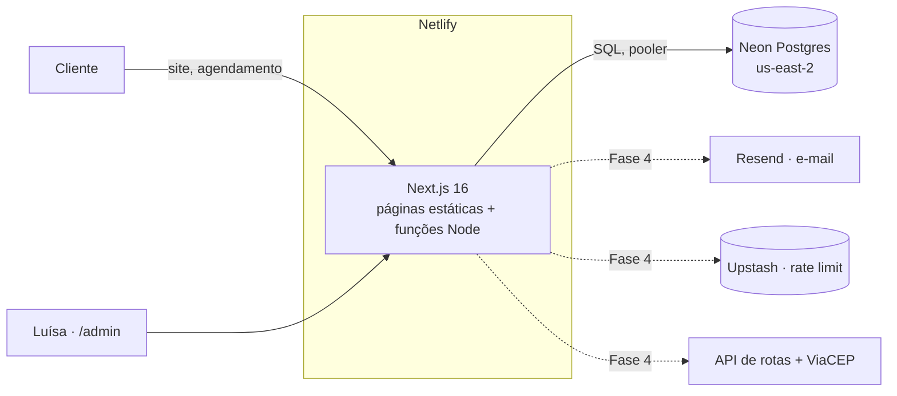
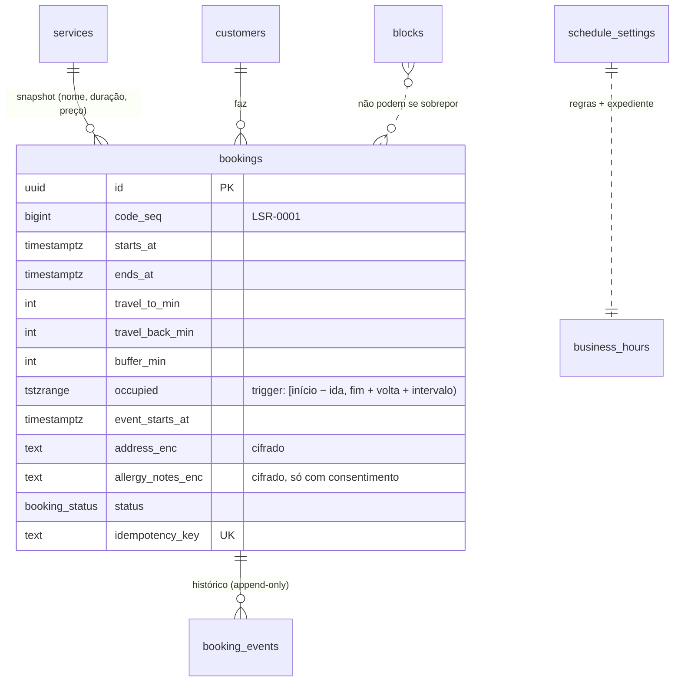
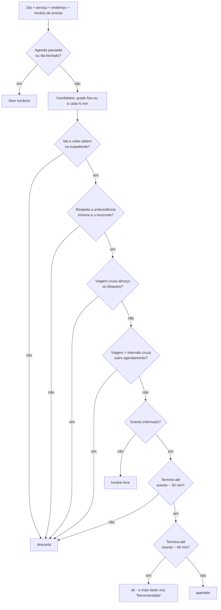

# Arquitetura

> Atualizado na Fase 3. Decisões detalhadas em [`docs/adr/`](adr).

## Contexto



O banco fica em **us-east-2 (Ohio)**, a mesma região padrão das funções da Netlify. Cada
agendamento faz várias consultas, e colocar o banco perto das funções evita somar ~130 ms de ida e
volta (Brasil ↔ EUA) a cada uma. A transferência internacional de dados está registrada para o
RoPA (LGPD, art. 33) na Fase 6.

## Componentes (código)

| Pasta                   | Responsabilidade                                                                             |
| ----------------------- | -------------------------------------------------------------------------------------------- |
| `src/app`               | Rotas, páginas e Route Handlers (camada fina)                                                |
| `src/components/site`   | Interface do site público                                                                    |
| `src/server/db`         | Esquema Drizzle, cliente e fábrica de conexões                                               |
| `src/server/scheduling` | **Regras da agenda**: fuso, disponibilidade, deslocamento (funções puras) e leitura do banco |
| `src/server/booking`    | Criação de agendamentos (transação, trava, idempotência, anti-abuso)                         |
| `src/server/crypto`     | Cifragem de campos sensíveis (AES-256-GCM)                                                   |
| `drizzle/`              | Migrações SQL versionadas (geradas + escritas à mão)                                         |

Regra: a interface nunca acessa o banco direto. Toda decisão (horário livre, preço, duração,
status) é calculada no servidor.

## Modelo de dados (Fase 3)



- **`occupied`** é calculado por _trigger_: a aplicação não consegue gravar um intervalo
  inconsistente.
- **`bookings_no_overlap`**: `EXCLUDE USING gist (occupied WITH &&) WHERE status IN
('pendente','confirmado')`. Dois agendamentos ativos nunca se sobrepõem, nem no deslocamento.
- **`booking_events`** só aceita INSERT (trigger bloqueia UPDATE e DELETE).
- Campos sensíveis (`*_enc`) são cifrados na aplicação, com a chave fora do banco.

## Algoritmo de disponibilidade



Implementação: `computeDaySlots` em `src/server/scheduling/availability.ts`, uma função pura
com 30+ testes (fuso, virada de dia/ano, horário de verão histórico, almoço, bloqueios,
intervalo, deslocamento e regra do evento).

## Criação de um agendamento

```mermaid
sequenceDiagram
  participant App as Servidor
  participant DB as Postgres
  App->>DB: idempotency_key já existe? → devolve o mesmo
  App->>DB: BEGIN; pg_advisory_xact_lock(agenda)
  App->>DB: regras + expediente + ocupação + bloqueios
  App->>App: recalcula os horários; o escolhido ainda existe?
  alt não existe
    App-->>App: erro "slot-taken" → tela "acabou de ser reservado"
  else existe
    App->>DB: limite de pendentes por contato
    App->>DB: upsert cliente; INSERT agendamento (cifrado) + evento
    DB-->>App: EXCLUDE garante (23P01 → "slot-taken")
    App->>DB: COMMIT
  end
```

Teste de concorrência: 10 conexões paralelas pedindo o mesmo horário resultam em exatamente 1
agendamento (`tests/db/concurrency.test.ts`).

## Desempenho: decisões registradas

- **`experimental.inlineCss` foi testado e descartado (Fase 7).** Ele ganharia cerca de 300 ms de LCP no celular (sem CSS bloqueando a renderização). Porém o `<style>` gerado vem **sem nonce**, e a CSP das áreas com nonce (`/agendar`, `/admin`) bloqueia esse CSS: a página de login fica sem estilo. Liberar `<style>` sem nonce enfraqueceria a CSP do painel. A segurança vence.
- O LCP da página inicial é a foto do topo (34 KB, `priority`). Medição local com Lighthouse em celular simulado: nota de 82 a 88 conforme a execução, LCP de 3,2 a 3,8 s, CLS 0 e TBT de cerca de 300 ms.
