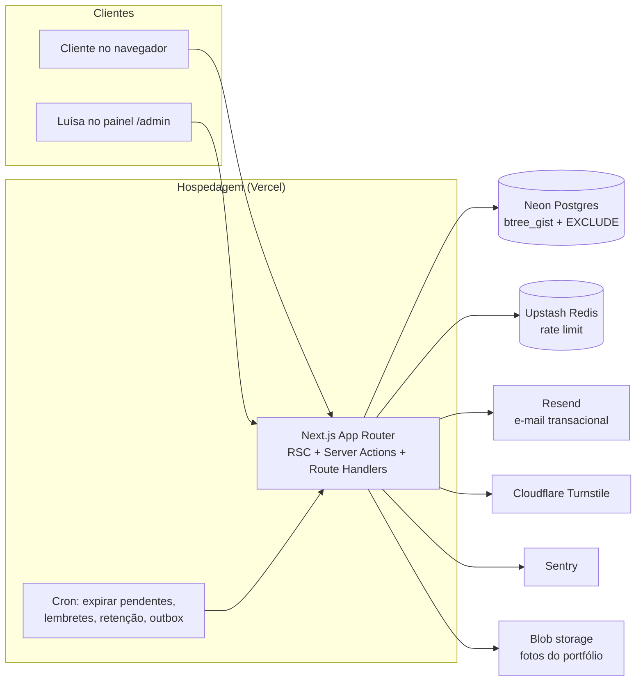
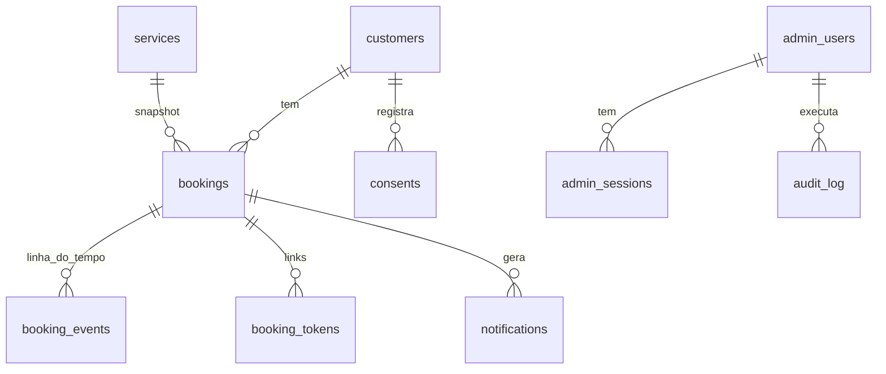

# Fase 0 · Descoberta

> Site, agendamento online e painel administrativo da **Luísa Silva Ramos, maquiadora profissional**.
> Status: **aguardando aprovação do Leo**. Nenhum código de produção foi escrito.
> Data: 27/11/2026.

Fontes lidas:

- Canvas "Luísa Silva Ramos: Site e Agendamento": 49 artboards em 3 páginas. A lógica está em `Main.dc.html`, `Agendar.dc.html` e `Admin.dc.html`; os demais artboards importam esses três com `tela`/`estado`/`view`.
- As duas folhas de estilo compartilhadas (tokens, hover, foco, animações, `prefers-reduced-motion`) e a foto da Luísa (`.webp`, 273 KB).
- Canvas "Logo Leonardo Almeida Canto": monograma LAC e as assinaturas "Desenvolvido por" (clara e escura).

---

## 1. O que o design define (inventário)

### 1.1 Tokens

| Token        | Valor                                  | Uso no design                                       |
| ------------ | -------------------------------------- | --------------------------------------------------- |
| `gold`       | `#F2B705`                              | CTA principal, selecionado, dia de hoje             |
| `butter`     | `#F8DE7E`                              | hover do CTA, destaques no escuro                   |
| `gold-burnt` | `#C9972B`                              | bordas de seleção, sublinhados, foco do campo       |
| `gold-text`  | `#7A5A12`                              | links e rótulos dourados sobre claro (contraste AA) |
| `espresso`   | `#2B1D14`                              | texto principal, fundos escuros                     |
| `brown`      | `#6B5444`                              | texto secundário                                    |
| `sand`       | `#F5EBDD`                              | fundo do site                                       |
| `cream`      | `#FBF6EE`                              | fundo de seções e campos                            |
| `card`       | `#FFFDF8`                              | cartões                                             |
| `line`       | `#E3D3BC` / `#EADBC4` / `#DCC9AE`      | bordas                                              |
| `olive`      | `#7A8B3C` (fg `#4F5B22`, bg `#EEF1DF`) | status confirmado, folga OK                         |
| `terra`      | `#B5543A` (fg `#9C4630`, bg `#FBEDE7`) | erro, cancelado, folga apertada                     |
| `pending`    | bg `#FFF1BF`, fg `#6B4E00`             | status pendente                                     |
| `done`       | bg `#F3E6CC`, fg `#6E5216`             | status concluído                                    |
| `muted`      | `#9C8B7C`                              | desabilitado/ocupado                                |

- **Tipografia:** Cormorant Garamond (títulos, 300 a 600 e itálico), Jost (texto e UI, 300 a 600) e Sora 600 (só a assinatura do desenvolvedor). Vão ser self-hosted via `next/font`.
- **Breakpoints:** mobile < 720 px, tablet de 720 a 1099 px, desktop ≥ 1100 px. Os mesmos valores aparecem nos três arquivos.
- **Movimento:** blob morfando, brilhos (twinkle), revelação e parallax por `animation-timeline` (com fallback visível), entrada dos passos, gaveta, pop e skeleton com shimmer. Tudo é desligado com `prefers-reduced-motion`.

### 1.2 Telas e estados (todos serão implementados)

- **Site:** header que muda ao rolar (fundo e sombra depois de 24 px), menu mobile (hambúrguer animado), hero, sobre, 4 serviços, portfólio em colunas (3 no desktop e 2 no mobile) com lightbox de 9 itens (anterior/próximo e contador "n / 09"), "Como funciona" (4 passos), depoimentos (carrossel de 3 com dots e `aria-live`), CTA final, contato (formulário + aside), rodapé com assinatura e botão flutuante de WhatsApp.
- **Agendamento:**
  - Passo 1: serviço (radiogroup).
  - Passo 2: calendário com legenda, slots, skeleton, "sem horários" com sugestões e "acabou de ser reservado".
  - Passo 3: rótulos flutuantes, máscara de WhatsApp, evento, local estúdio/domicílio e resumo lateral.
  - Passo 4: revisão com "Editar" por item, aceite da política, "Confirmando…" e erro com "Tentar de novo".
  - Minha agenda: confirmação, dados, mini calendário, Google/Apple/.ics, WhatsApp, reagendar, cancelar, próximos passos, dicas, modais e toast.
- **Admin:**
  - Acesso: login (erro, bloqueio, sessão expirada), recuperar senha, 2FA (6 campos).
  - Shell: sidebar 264 px (desktop), 84 px (tablet, só ícones) e barra inferior (mobile).
  - Telas: Dashboard (alerta de folga apertada, KPIs, próximo atendimento com contagem, agenda de hoje, gráfico semanas/meses, ranking de serviços, pendentes com confirmar/recusar), Agenda (mês, semana e dia, filtros, arrastar, linha do "agora", bloqueios hachurados, vazia), Lista (busca, filtros, ordenação, paginação, CSV, sem resultado, cards no mobile), Clientes, Perfil, Serviços, Horários e regras + bloqueios, gaveta de detalhes, modal de cancelar, modal de novo agendamento/bloqueio, notificações e toasts.

---

## 2. Lacunas e inconsistências do design (com proposta mínima, na mesma linguagem visual)

| #   | Lacuna / inconsistência                                                                                                                                                                                                                                                                                     | Proposta                                                                                                                                                                                                                                                                                                    |
| --- | ----------------------------------------------------------------------------------------------------------------------------------------------------------------------------------------------------------------------------------------------------------------------------------------------------------- | ----------------------------------------------------------------------------------------------------------------------------------------------------------------------------------------------------------------------------------------------------------------------------------------------------------- |
| L1  | A tela de sucesso diz **"Agendamento confirmado!"** e o status "Confirmado", mas "Confirmar manualmente" vem **ligado** por padrão.                                                                                                                                                                         | Variante **"Pedido recebido!"** com status **"Aguardando confirmação"** (cores de pendente). "Confirmado" só aparece se a confirmação for automática ou depois que a Luísa confirmar.                                                                                                                       |
| L2  | Não existe tela para **chegar** à "Minha agenda" depois de fechar a aba.                                                                                                                                                                                                                                    | Página `/agendar/minha-agenda` sem token, com um campo (e-mail **ou** WhatsApp) e a resposta genérica "Se houver agendamento, enviamos o link para o seu e-mail". O link chega por e-mail.                                                                                                                  |
| L3  | O código `#LSR-0001` está fixo e o reagendar/cancelar da cliente não tem estado de **"fora do prazo da política"**.                                                                                                                                                                                         | Botões desabilitados com a explicação "Para mudanças com menos de X h, fale com a Luísa no WhatsApp".                                                                                                                                                                                                       |
| L4  | O campo "Observações: tipo de pele…" pode receber **alergias** (dado de saúde, art. 11 da LGPD).                                                                                                                                                                                                            | Separar em dois campos: "Referência de look e tipo de pele (opcional)" e "**Alergias ou sensibilidades** (opcional)". O segundo só é liberado com um checkbox de consentimento específico e destacado.                                                                                                      |
| L5  | O admin não tem telas de **portfólio, depoimentos, textos/contatos do site, mensagens do formulário (leads), solicitações LGPD, log de auditoria, segurança da conta** (trocar senha, 2FA, sessões ativas, "sair de todos os dispositivos"). O item "Configurações" do menu aparece como "tela a desenhar". | **Configurações** com abas no estilo de "Horários e regras": _Site_ (contatos, cidade, endereço, textos curtos), _Portfólio_ (upload, ordem, categoria, alt), _Depoimentos_, _Políticas_, _Conta e segurança_, _Auditoria_. **Mensagens** (leads) e **Privacidade (LGPD)** entram como itens novos do menu. |
| L6  | Sem **404, 500, manutenção/agendamentos pausados**, páginas legais e **banner de cookies**.                                                                                                                                                                                                                 | Páginas simples sobre `sand`, título em Cormorant e CTA dourado. Banner de cookies no rodapé, no padrão dos toasts.                                                                                                                                                                                         |
| L7  | Os cards de serviço do site levam a `#contato` ("SAIBA MAIS").                                                                                                                                                                                                                                              | Proposta: "AGENDAR ESTE SERVIÇO" leva a `/agendar?servico=noiva`, com o serviço pré-selecionado. Se preferir, mantenho `#contato`.                                                                                                                                                                          |
| L8  | O formulário de contato não tem campo de **e-mail** nem aceite de privacidade.                                                                                                                                                                                                                              | Mantenho os campos do design e acrescento só a frase "Ao enviar, você concorda com a Política de Privacidade" com link. A resposta vai por WhatsApp.                                                                                                                                                        |
| L9  | Na gaveta, "Pagamento: Sinal pago / Pago / Pendente" aparece sem tela para alterar.                                                                                                                                                                                                                         | Um seletor no próprio bloco "Pagamento" da gaveta, com forma (Pix, cartão, dinheiro) e status.                                                                                                                                                                                                              |
| L10 | Arrastar diz "a cliente recebe a mudança pelo WhatsApp após você confirmar". Com `wa.me`, o envio **não é automático**.                                                                                                                                                                                     | Depois de soltar o bloco: modal "Confirmar reagendamento?" com e-mail automático para a cliente e o botão "Avisar no WhatsApp" (abre o `wa.me` com a mensagem pronta). O mesmo vale para "Enviar lembrete".                                                                                                 |
| L11 | "Novo agendamento" (admin) oferece horários fixos e não pede e-mail nem dados de domicílio.                                                                                                                                                                                                                 | Os horários vêm do mesmo algoritmo. A opção "**Encaixe** (ignorar regras)" respeita apenas o conflito real de horário. E-mail opcional; endereço quando for domicílio.                                                                                                                                      |
| L12 | KPI "vs. sábado passado" fixo.                                                                                                                                                                                                                                                                              | "vs. mesmo dia da semana passada". KPIs e gráficos mostram estado vazio até haver 4 semanas de histórico.                                                                                                                                                                                                   |
| L13 | Não há tela para **definir a nova senha** (o link de recuperação abre onde?) nem para **cadastrar o 2FA**.                                                                                                                                                                                                  | "Criar nova senha" e "Ativar verificação em 2 etapas" (QR code + 10 códigos de recuperação), com o layout do login.                                                                                                                                                                                         |
| L14 | A tela de Clientes não tem busca.                                                                                                                                                                                                                                                                           | Campo de busca igual ao da Lista.                                                                                                                                                                                                                                                                           |
| L15 | A assinatura do rodapé usa "Leo Almeida Canto" e o monograma LAC. O briefing diz "Leo Designs".                                                                                                                                                                                                             | Pergunta P30.                                                                                                                                                                                                                                                                                               |

---

## 3. Arquitetura proposta



- **Um único app Next.js** (monólito modular). As fronteiras ficam em `src/server/{booking,availability,auth,notifications,lgpd}`. A UI nunca acessa o banco direto: tudo passa por serviços de domínio validados com Zod.
- **Server Actions** para formulários (CSRF já protegido por checagem de Origin no Next, e adicionamos um token próprio no admin). **Route Handlers** para `.ics`, CSV, cron, health e webhooks futuros.
- **Outbox de e-mail:** o e-mail é gravado na mesma transação do agendamento e enviado logo depois (`after()`). Uma varredura periódica reenvia o que falhou. Assim, se o e-mail falhar, o agendamento **não** se perde.
- **Fuso:** o banco grava tudo em `timestamptz` (UTC). Regras e exibição usam `America/Sao_Paulo` com `@date-fns/tz`. O Brasil não tem horário de verão desde 2019, mas os testes cobrem datas históricas.

### Fluxo de agendamento

```mermaid
sequenceDiagram
  participant Cli as Cliente
  participant App as Next.js (servidor)
  participant DB as Postgres
  Cli->>App: GET disponibilidade (serviço, mês/dia)
  App->>DB: regras + bloqueios + agendamentos ativos
  App-->>Cli: dias/horários livres (calculados no servidor)
  Cli->>App: confirmar (idempotency key, dados, Turnstile)
  App->>App: rate limit + validação Zod + recalcula slot
  App->>DB: BEGIN; advisory lock da agenda; revalida; INSERT
  alt horário tomado (EXCLUDE viola)
    DB-->>App: erro 23P01
    App-->>Cli: "Esse horário acabou de ser reservado" (dados preservados no cliente)
  else ok
    DB-->>App: COMMIT (booking + token + evento + outbox)
    App-->>Cli: redireciona para Minha agenda (cookie do token)
    App->>App: envia e-mails (cliente e Luísa)
  end
```

---

## 4. Modelo de dados (resumo; o ER completo vai para `docs/architecture.md` na Fase 3)



| Tabela                                             | Campos principais / observações                                                                                                                                                                                                                                                                                                                                                                                                                                                                                                                                  |
| -------------------------------------------------- | ---------------------------------------------------------------------------------------------------------------------------------------------------------------------------------------------------------------------------------------------------------------------------------------------------------------------------------------------------------------------------------------------------------------------------------------------------------------------------------------------------------------------------------------------------------------- |
| `services`                                         | `slug`, `name`, `category`, `duration_min`, `price_cents`, `description`, `active`, `sort_order`                                                                                                                                                                                                                                                                                                                                                                                                                                                                 |
| `business_hours`                                   | `weekday` 0 a 6, `is_open`, `opens_at`, `closes_at`                                                                                                                                                                                                                                                                                                                                                                                                                                                                                                              |
| `schedule_settings` (linha única)                  | `buffer_min` (0/15/30), `min_notice_hours` (12/24/48), `lunch_enabled/start/end`, `manual_confirmation`, `min_event_gap_min`, `slot_mode` (grid/auto), `slot_grid[]`, `slot_step_min`, `horizon_days`, `pending_expiry_hours`, `cancel_window_hours`, `max_pending_per_contact`, `travel_fee_cents`, `bookings_paused`                                                                                                                                                                                                                                           |
| `blocks`                                           | `starts_at`, `ends_at`, `all_day`, `reason` (só a Luísa vê)                                                                                                                                                                                                                                                                                                                                                                                                                                                                                                      |
| `customers`                                        | `name`, `phone_e164`, `email` (citext), `internal_notes_enc`, `anonymized_at`                                                                                                                                                                                                                                                                                                                                                                                                                                                                                    |
| `bookings`                                         | `id` uuid, `code_seq` (exibido como `LSR-0001`), `customer_id`, _snapshot_ do serviço (nome, duração, valor), `starts_at`, `ends_at`, `buffer_min`, `occupied` (tstzrange gerado = `[starts_at, ends_at + buffer)`), `status` (pendente, confirmado, concluido, cancelado), `cancel_reason`, `event_starts_at`, `event_duration`, `location_type`, `address_enc`, `complement_enc`, `look_notes_enc`, `allergy_notes_enc`, `payment_method`, `payment_status`, `internal_notes_enc`, `source` (site/admin), `idempotency_key` (unique), `expires_at`, timestamps |
|                                                    | **`EXCLUDE USING gist (occupied WITH &&) WHERE (status IN ('pendente','confirmado'))`**                                                                                                                                                                                                                                                                                                                                                                                                                                                                          |
| `booking_tokens`                                   | `token_hash` (SHA-256 de 32 bytes aleatórios), `scope` (view/manage), `expires_at`, `revoked_at`                                                                                                                                                                                                                                                                                                                                                                                                                                                                 |
| `booking_events`                                   | `type`, `actor` (admin/cliente/sistema), `data` jsonb: a linha do tempo da gaveta                                                                                                                                                                                                                                                                                                                                                                                                                                                                                |
| `notifications`                                    | central do painel (`read_at`)                                                                                                                                                                                                                                                                                                                                                                                                                                                                                                                                    |
| `email_outbox`                                     | `template`, `payload`, `status`, `attempts`, `next_attempt_at`, `provider_id`                                                                                                                                                                                                                                                                                                                                                                                                                                                                                    |
| `leads`                                            | mensagens do formulário de contato                                                                                                                                                                                                                                                                                                                                                                                                                                                                                                                               |
| `consents`                                         | `kind` (politica_cancelamento, dados_saude, privacidade), `text_version`, `granted_at`, `ip`, `user_agent`                                                                                                                                                                                                                                                                                                                                                                                                                                                       |
| `admin_users`, `admin_sessions`, `auth_tokens`     | Argon2id, TOTP cifrado, códigos de recuperação com hash, sessão no banco (revogável)                                                                                                                                                                                                                                                                                                                                                                                                                                                                             |
| `audit_log`                                        | append-only (o usuário da app não tem `UPDATE`/`DELETE`, e um trigger bloqueia). Guarda quem, ação, entidade, antes/depois, IP, user-agent e data                                                                                                                                                                                                                                                                                                                                                                                                                |
| `dsr_requests`                                     | pedidos LGPD (acesso, correção, exportação, exclusão)                                                                                                                                                                                                                                                                                                                                                                                                                                                                                                            |
| `portfolio_items`, `testimonials`, `site_settings` | só se as lacunas L5 forem aprovadas                                                                                                                                                                                                                                                                                                                                                                                                                                                                                                                              |

Por que o código não vaza: `LSR-0001` é sequencial e **público**, mas não dá acesso a nada. O acesso da cliente exige o token (256 bits) e o banco guarda só o hash dele.

---

## 5. Algoritmo de disponibilidade (100% no servidor)

Entrada: `serviceId`, `date` (dia em `America/Sao_Paulo`) e `now`.

1. Pega o expediente do dia da semana. Se for "Fechado", não há slots. Se `bookings_paused`, nenhum slot.
2. Calcula `dur = service.duration_min` e `buf = settings.buffer_min`.
3. **Candidatos:**
   - modo `grid`: os horários da grade (ex.: 08:00, 09:30, 11:00, 14:00, 15:30, 17:00);
   - modo `auto`: de `opens_at` até `closes_at - dur`, de `slot_step_min` em `slot_step_min` minutos.
4. Para cada início `s` (com `e = s + dur`), o slot é **válido** se todas as condições abaixo valem:
   - `s ≥ now + min_notice_hours` e `s ≤ hoje + horizon_days`;
   - `opens_at ≤ s` e `e ≤ closes_at`;
   - `[s, e)` não cruza o almoço (se ligado);
   - `[s, e)` não cruza nenhum bloqueio;
   - `[s, e + buf)` não cruza nenhum `occupied` de agendamentos **pendentes ou confirmados**. O intervalo fica garantido **depois** de cada atendimento e vale nos dois sentidos, porque cada agendamento guarda o próprio buffer.
5. Com a lista vazia, aparece "agenda completa" e a sugestão dos **3 próximos dias com vaga**, buscando até 60 dias à frente.
6. **Mês:** a mesma função, em lote, com uma consulta só para o intervalo do mês, devolve quais dias têm vaga.
7. **Ao confirmar:** recalcula tudo na transação, com `pg_advisory_xact_lock`. A `EXCLUDE` é a última barreira contra corrida.
8. **Evento:**
   - `fim_make = s + dur` e `folga = event_starts_at − fim_make`;
   - `folga ≤ 0`: **erro** ("O evento começa antes do fim da maquiagem");
   - `0 < folga < min_event_gap_min` (padrão 60 min, que é o número usado no design): **aviso** à cliente e marca "aperto" no painel.

Casos de teste já previstos: almoço, bloqueio parcial e de dia inteiro, buffer antes e depois, antecedência atravessando a meia-noite, último dia do mês e virada de ano, serviço longo (Noiva, 150 min) que "come" o slot seguinte da grade, expediente alterado com agendamentos já existentes, e as datas históricas de horário de verão (ex.: 04/11/2018 e 17/02/2019).

---

## 6. Segurança: decisões-chave (detalhes em `docs/security/` na Fase 6)

- **Admin:** a sessão fica no banco (cookie `__Host-`, `HttpOnly`, `Secure`, `SameSite=Lax`), com rotação no login e no 2FA. Expira por inatividade (2 h) e tem prazo absoluto: 12 h, ou 30 dias com "Manter conectada" (que vale só para o dispositivo, nunca para o 2FA). Há "Sair de todos os dispositivos".
- **2FA recomendado: TOTP** (app autenticador) + 10 códigos de recuperação. O design mostra um código "enviado por e-mail/WhatsApp", mas com código por e-mail quem invade o e-mail recebe **tanto** o link de redefinição de senha **quanto** o código, e os dois fatores viram um. Só o texto do subtítulo muda. Pergunta P27.
- **Bloqueio de login:** 5 tentativas em 5 min por conta+IP mostram "Muitas tentativas. Tente novamente em 5 minutos", com backoff progressivo.
- **Cliente:** token de link em cookie `HttpOnly` de escopo `/agendar`, trocado pelo link do e-mail. O link redireciona para uma URL limpa (sem o token, para não vazar em histórico ou referrer). Expira 30 dias depois do atendimento.
- **Anti-abuso na reserva:** Turnstile, rate limit por IP, e no máximo N pendentes por WhatsApp/e-mail (padrão 2). Pendentes não confirmadas expiram em X h e liberam o horário.
- **Cifragem de campos** (endereço, observações, alergias, notas): AES-256-GCM com chave versionada (`ENC_KEYS=v1:...`), que permite rotação sem downtime.
- **CSP estrita com nonce**, HSTS (preload depois do go-live), `frame-ancestors 'none'`, `Referrer-Policy: strict-origin-when-cross-origin` (e `no-referrer` nas páginas com token).
- **Logs** estruturados sem PII (IDs em vez de nomes). Os registros de acesso ficam 6 meses: o **Marco Civil da Internet, art. 15** exige isso para provedores de aplicação.

---

## 7. Hospedagem e custos (verificado em 27/11/2026)

### ⚠️ Achado importante: o plano gratuito da Vercel (Hobby) **não permite uso comercial**

Pelas [diretrizes de uso justo da Vercel](https://vercel.com/docs/limits/fair-use-guidelines), o Hobby é só para uso pessoal não comercial, e qualquer uso comercial exige Pro ou Enterprise. Um site que vende atendimentos é comercial. Além disso, no Hobby o cron roda [no máximo 1 vez por dia](https://vercel.com/docs/cron-jobs/usage-and-pricing), o que não atende expiração de pendentes nem a reenvio de e-mails.

| Opção                           | Custo                                                                                                                      | Prós                                                                                              | Contras                                                                                                                                                                     |
| ------------------------------- | -------------------------------------------------------------------------------------------------------------------------- | ------------------------------------------------------------------------------------------------- | --------------------------------------------------------------------------------------------------------------------------------------------------------------------------- |
| **A. Vercel Pro (recomendada)** | US$ 20/mês por usuário ([pricing](https://vercel.com/pricing)). Com 1 usuário (você), ≈ R$ 110 a 130/mês conforme o câmbio | Melhor suporte a Next.js, preview por PR, cron de até 1/min, firewall, logs, rollback em 1 clique | É o único custo fixo relevante                                                                                                                                              |
| B. Netlify Free                 | R$ 0 (300 créditos/mês, [pricing](https://www.netlify.com/pricing))                                                        | Uso comercial permitido no plano free                                                             | Se os créditos acabarem, o site é **suspenso até o mês seguinte**: risco de agenda fora do ar; precisa de cron externo                                                      |
| C. Cloudflare Workers Free      | R$ 0                                                                                                                       | Barato, CDN global                                                                                | 10 ms de CPU por requisição ([limites](https://developers.cloudflare.com/workers/platform/limits)): inviável para Argon2id e SSR pesado; o adaptador Next.js tem limitações |
| D. VPS (Hetzner + Coolify)      | ≈ € 4 a 6/mês                                                                                                              | Controle total                                                                                    | Você vira o "time de infraestrutura": patch de SO, backup, TLS e uptime são seus                                                                                            |
| ~~Vercel Hobby~~                | R$ 0                                                                                                                       |                                                                                                   | **Viola os termos.** Não recomendo                                                                                                                                          |

### Demais serviços (planos gratuitos)

| Serviço                                                             | Limite gratuito (fonte oficial)                                                          | Basta?                                   | Ponto de upgrade                                                               |
| ------------------------------------------------------------------- | ---------------------------------------------------------------------------------------- | ---------------------------------------- | ------------------------------------------------------------------------------ |
| [Neon](https://neon.com/docs/introduction/plans)                    | 100 CU-h/mês, **1 GB** por projeto, restore instantâneo de **6 h**                       | Sim, para o volume dela                  | Mais de 1 GB, ou quando quisermos PITR de 7+ dias (plano Launch, pago por uso) |
| [Resend](https://resend.com/docs/knowledge-base/resend-email-quota) | 3.000 e-mails/mês e **100/dia**                                                          | Sim (cerca de 4 e-mails por agendamento) | Campanhas, ou mais de 25 agendamentos por dia                                  |
| [Upstash Redis](https://upstash.com/pricing/redis)                  | 500 mil comandos/mês                                                                     | Sim                                      | Ataque prolongado (o rate limit degrada para "modo restrito")                  |
| [Upstash QStash](https://upstash.com/pricing/qstash)                | 1.000 mensagens/dia                                                                      | Só necessário na opção B                 |                                                                                |
| Cloudflare Turnstile                                                | Gratuito                                                                                 | Sim                                      |                                                                                |
| Sentry (Developer)                                                  | Plano gratuito com cota mensal de erros                                                  | Sim                                      | A confirmar na Fase 1                                                          |
| Monitor de uptime                                                   | Vários com plano free. **Verificarei se o free permite uso comercial** antes de escolher |                                          |                                                                                |
| Domínio `.com.br` (Registro.br)                                     | ≈ R$ 40/ano                                                                              |                                          |                                                                                |

**Custo estimado com a opção A:** ≈ US$ 20/mês + R$ 40/ano de domínio. Todo o resto fica em R$ 0 no começo.

### Dois cuidados de engenharia com os planos gratuitos

1. **Neon "acordado" o tempo todo estoura a cota de compute.** Um cron a cada 5 min ou um monitor de uptime que consulte o banco impede o banco de suspender: 0,25 CU × 720 h = 180 CU-h, acima dos 100. Por isso:
   - os jobs rodam **de hora em hora**;
   - o `/api/health` usado pelo monitor **não toca no banco**;
   - um health "profundo" com banco roda 1×/hora.
2. **Restore de só 6 h no Neon free.** Vou complementar com um **dump diário cifrado** (GitHub Actions + `pg_dump` + `age`) num storage gratuito. Isso dá **RPO ≤ 24 h** para incidentes descobertos tarde, e **≈ 0** se a gente perceber em até 6 h. RTO alvo: 4 h. SLO: 99,9% mensal, limitado pelos SLAs dos provedores.

---

## 8. Riscos

| Risco                                                                              | Impacto                                                                       | Mitigação                                                                                                                               |
| ---------------------------------------------------------------------------------- | ----------------------------------------------------------------------------- | --------------------------------------------------------------------------------------------------------------------------------------- |
| **CDC art. 49:** direito de arrependimento de 7 dias em contratações pela internet | "Sinal não reembolsável" pode ser abusivo se a cliente desistir em até 7 dias | Revisão jurídica da política (o rascunho já prevê isso)                                                                                 |
| **Decreto 7.962/2013** exige no site nome, CPF/CNPJ, **endereço físico** e contato | Multa (Procon)                                                                | Rodapé e página "Sobre a empresa". Precisa dos dados (P9 a P11)                                                                         |
| Alergias = dado sensível                                                           | Sanção da ANPD                                                                | Campo separado, consentimento específico, cifragem, retenção curta                                                                      |
| Só uma administradora (Luísa) perde o celular ou o 2FA                             | Fica fora do painel                                                           | Códigos de recuperação impressos e um segundo admin "de emergência" (você?) com 2FA próprio                                             |
| WhatsApp via `wa.me` depende de clique manual                                      | Lembrete esquecido                                                            | Lembrete automático **por e-mail**. WhatsApp Cloud API como evolução opcional (custo por mensagem na tabela da Meta, a orçar na Fase 8) |
| Limite de 100 e-mails/dia do Resend                                                | E-mails não enviados num dia de pico                                          | Outbox com retry no dia seguinte + alerta. Upgrade se o volume crescer                                                                  |
| Container desta sessão é efêmero                                                   | Perda de trabalho                                                             | Preciso de um repositório no GitHub (P31)                                                                                               |

---

## 9. ADRs propostos (em `docs/adr/`, status "Proposto")

0001 hospedagem · 0002 Next.js + TypeScript strict · 0003 Postgres Neon + Drizzle · 0004 concorrência (EXCLUDE + advisory lock) · 0005 autenticação do admin (Better Auth, sessão no banco, TOTP) · 0006 e-mail (Resend + outbox) · 0007 tarefas agendadas · 0008 tokens de acesso da cliente · 0009 cifragem de campos sensíveis · 0010 rate limit e anti-bot.

---

## 10. Plano de fases (confirmado, sem mudanças de escopo)

0 Descoberta (este documento) → 1 Fundação → 2 Site → 3 Núcleo de agendamento → 4 Fluxo da cliente → 5 Painel → 6 Automação e LGPD → 7 Endurecimento → 8 Go-live. Uma branch por fase, PR para `main` com CI verde.

---

# Revisão 1: respostas do Leo (27/11/2026)

> Esta seção **substitui** o que estiver em conflito nas seções 1 a 10.

## R1. Decisões fechadas

| #       | Decisão                                                                                                                                                                                                                                                       |
| ------- | ------------------------------------------------------------------------------------------------------------------------------------------------------------------------------------------------------------------------------------------------------------- |
| P2      | Domínio `luisasilvaramos.com.br`. Titular: Luísa. Responsável técnico: Leo.                                                                                                                                                                                   |
| P3      | Valores e durações iniciais definidos por mim (tabela R2), **editáveis no painel**. O checklist de go-live exige revisão pela Luísa.                                                                                                                          |
| P4      | Teste prévio de noiva: fora do escopo por ora.                                                                                                                                                                                                                |
| P5      | **Artística/Editorial e Aulas removidas de tudo**: serviços, formulário de contato e categorias do portfólio.                                                                                                                                                 |
| P6/P7   | Dias, horários e grade (fixa ou automática) **editáveis no painel**. Padrão: terça a sábado, 08:00 às 19:00, grade **automática** a cada 30 min.                                                                                                              |
| P8/P13  | Regra do evento (R3).                                                                                                                                                                                                                                         |
| P10/P14 | **Não existe estúdio.** Todo atendimento é no local da cliente, com **taxa de deslocamento automática** e **tempo de ida e volta bloqueado na agenda** (R4).                                                                                                  |
| P12     | Confirmação manual **ligada**. Pendente expira em 24 h (editável).                                                                                                                                                                                            |
| P15     | Atendimento fora do expediente só como "encaixe" feito pela Luísa no painel.                                                                                                                                                                                  |
| P16     | Cancelar ou remarcar pela cliente: até **48 h antes** do início da make.                                                                                                                                                                                      |
| P17     | **Contrato eletrônico automático** gerado no fim do agendamento (R5).                                                                                                                                                                                         |
| P18     | Pix online: fase opcional.                                                                                                                                                                                                                                    |
| P9      | Identificação da contratada: Luísa Silva Ramos + CPF (só em variável de ambiente, nunca no repositório). Ver risco R6.                                                                                                                                        |
| P11     | WhatsApp +55 11 93054-6322. Notificações vão para o Gmail da Luísa. Instagram oculto até existir (liga/desliga no painel).                                                                                                                                    |
| P24     | Retenção: alergias apagadas 30 dias após o atendimento, leads em 6 meses, clientes inativas anonimizadas em 2 anos e registros de acesso por 6 meses (Marco Civil). Contratos ficam 5 anos (prazo prescricional do CDC, art. 27); sujeito à revisão jurídica. |
| P25     | Campo de alergias separado, com consentimento específico.                                                                                                                                                                                                     |
| P26     | Analytics **sem cookies** (Cloudflare Web Analytics, gratuito). Sem pixels de anúncio. Com isso não há cookies não essenciais e **o banner de consentimento não é necessário**; fica só o aviso na Política de Privacidade.                                   |
| P27/P28 | TOTP para a Luísa. Leo como administrador de emergência, com 2FA próprio.                                                                                                                                                                                     |
| P29     | Lacunas L1 a L15 aprovadas. As que falavam de estúdio passam a valer para "local do atendimento".                                                                                                                                                             |
| P30     | Rodapé: "Desenvolvido por: Leo Almeida Canto" com o monograma LAC, variante escura (o rodapé é escuro).                                                                                                                                                       |
| P33     | Lembrete na véspera às 18h, mais um resumo diário para a Luísa.                                                                                                                                                                                               |

## R2. Serviços iniciais (sugestão; a Luísa ajusta no painel)

| Serviço                         | Duração | Valor inicial |
| ------------------------------- | ------- | ------------- |
| Maquiagem Social                | 60 min  | R$ 200        |
| Maquiagem para Noivas           | 150 min | R$ 750        |
| Maquiagem para Formaturas       | 90 min  | R$ 250        |
| Maquiagem para Eventos e Festas | 75 min  | R$ 220        |

As durações vêm do design. Os valores são só um ponto de partida e **não podem ir ao ar sem a Luísa confirmar**.

## R3. Regra do horário do evento (interpretação; aguarda confirmação)

Sendo **E** o início do evento:

- **Pronta até:** `E − 30 min`. É o **limite**: nenhum horário cuja make termine depois disso é oferecido.
- **Recomendado:** a make termina até `E − 30 − 60 = E − 90 min`.

Exemplo: evento às 19:00 → pronta até 18:30 → recomendado terminar até 17:30. Para Noiva (2h30), isso significa começar até 15:00.

No passo de horários:

- o slot mais tarde que respeita a recomendação ganha o selo **"Recomendado"**;
- os slots entre a recomendação e o limite aparecem com aviso de **"apertado"** e são marcados como "aperto" no painel;
- os slots depois do limite não aparecem.

As duas margens (30 e 60 min) são editáveis no painel.

## R4. Deslocamento (novo)

- **Endereço da cliente:** por CEP (ViaCEP), mais número e complemento.
- **Rota:** distância e tempo calculados por API de rotas a partir do **endereço-base da Luísa** (privado, cifrado e configurado no painel). O resultado fica em cache por endereço.
- **Taxa:** `max(taxa_mínima, km_ida_e_volta × R$/km)`, arredondada para cima em R$ 5. Valores iniciais: mínimo R$ 30, R$ 2,50/km e raio máximo de 40 km. Acima do raio aparece "Fale com a Luísa no WhatsApp". Tudo editável.
- **Tempo de deslocamento:** o tempo da rota × fator de segurança (1,3, por causa do trânsito de SP), arredondado para cima em múltiplos de 15 min.
- **Agenda:** cada atendimento ocupa `[início − ida, fim + volta + intervalo)`. A `EXCLUDE` do banco passa a usar esse intervalo completo. O expediente configurado inclui os deslocamentos.
- **Consequência no fluxo:** os horários livres dependem do endereço. Por isso o **local e o evento vêm antes do calendário**. Fluxo proposto (5 passos, mesmo visual da barra de progresso):
  1. Serviço
  2. **Evento e local**: horário e duração do evento, CEP e endereço; a taxa aparece aqui
  3. Data e horário, com o "Recomendado"
  4. Seus dados
  5. **Contrato e confirmação**
- **API:** Google Routes "Compute Routes Essentials" dá 10 mil requisições grátis por mês, mas **exige conta de faturamento com cartão**. A alternativa sem cartão (OpenRouteService) terá os termos verificados na Fase 3. Decisão final na Fase 3 (não bloqueia a Fase 1).

## R5. Contrato eletrônico (novo; o texto é **rascunho para revisão jurídica**)

- **Geração:** o contrato de prestação de serviços sai automaticamente com:
  - contratante: nome, **CPF**, WhatsApp, e-mail, endereço;
  - contratada: Luísa;
  - serviço, data, horário, local e preço (serviço + deslocamento);
  - forma e momento do pagamento;
  - cancelamento e remarcação até 48 h, atraso, não comparecimento, direito de arrependimento (CDC, art. 49), uso de imagem (opcional, com checkbox à parte) e foro.
- **Aceite:** a cliente lê, marca "Li e concordo" e **digita o nome completo**. É uma assinatura eletrônica simples (Lei 14.063/2020; MP 2.200-2/2001, art. 10, §2º).
- **Evidências guardadas:** versão do modelo, **hash SHA-256 do texto exato**, data e hora, IP e user-agent.
- **Cópias:** PDF enviado por e-mail à cliente e à Luísa e baixável na "Minha agenda".
- **Mudanças:** qualquer alteração (reagendar, mudar o valor) gera um **aditivo** com novo aceite.
- **Dado novo:** o CPF da contratante (validado pelos dígitos verificadores, cifrado). Base legal: execução de contrato (LGPD, art. 7º, V).

## R6. Riscos novos

1. **Decreto 7.962/2013:** o site precisa exibir CPF ou CNPJ **e endereço físico** da fornecedora. Publicar CPF e endereço residencial expõe a Luísa. **Recomendo abrir um MEI** (CNPJ gratuito; vale conversar com um contador) e avaliar um endereço comercial. Fica pendente para o go-live, sem bloquear as próximas fases.
2. **CPF no contrato:** toda cliente que agendar verá o CPF da Luísa no contrato. Com MEI, aparece o CNPJ.
3. **Penalidade por cancelamento tardio:** sem regra definida ainda (pergunta aberta). Qualquer multa precisa respeitar o art. 49 do CDC.

## R7. Hospedagem (P1 revista)

- **Vercel Hobby (free):** **não.** Os termos proíbem uso comercial; a conta pode ser pausada sem aviso, derrubando a agenda. Além disso, o cron roda no máximo 1×/dia.
- **Netlify Free:** R$ 0 e uso comercial permitido. Créditos: 300/mês. Deploy de produção custa 15 créditos; deploy de preview é grátis. Banda: 20 créditos/GB. Requisições: 2 créditos a cada 10 mil.
  - Para este site: ~4 deploys de produção por mês (60 créditos), mais tráfego e funções, ficaria por volta de 100 a 150 créditos.
  - Risco: estourar suspende o site até o mês seguinte. Mitigação: produção só recebe deploy em releases, alerta de consumo a 70% e upgrade quando necessário.
- **Recomendação nova:** começar na **Netlify Free**, com código portátil (nada específico de provedor). Migrar para Vercel Pro ou Netlify Pro depois é troca de configuração, não reescrita. Tarefas agendadas via Netlify Scheduled Functions, com QStash de reserva.
- **DNS:** mover para a Cloudflare (gratuito) para ter redirecionamento de e-mail (`privacidade@` e `contato@` → Gmail), Turnstile e analytics. O registro continua no Registro.br.

## R8. Pendências abertas (o resto está decidido)

1. Hospedagem: aprova a Netlify Free (R7)? **Bloqueia a Fase 1.**
2. Repositório no GitHub: criar vazio e vincular à sessão. **Bloqueia a Fase 1.**
3. A interpretação da regra do evento (R3) está certa?
4. Contrato: quando a cliente paga (no dia, Pix na hora, antecipado)? Cancelamento com menos de 48 h e não comparecimento têm cobrança? Pode coletar o CPF da cliente?
5. Endereço-base da Luísa (vale bairro + CEP), raio máximo e valores da taxa.
6. MEI / endereço público (R6.1), até o go-live.
7. A assinatura do rodapé tem link? Para onde?
